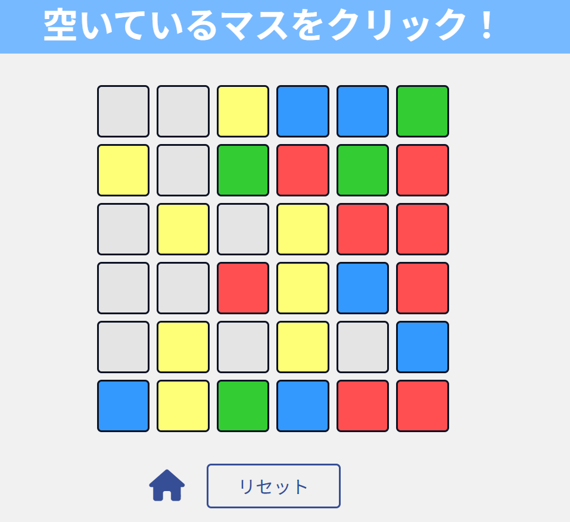
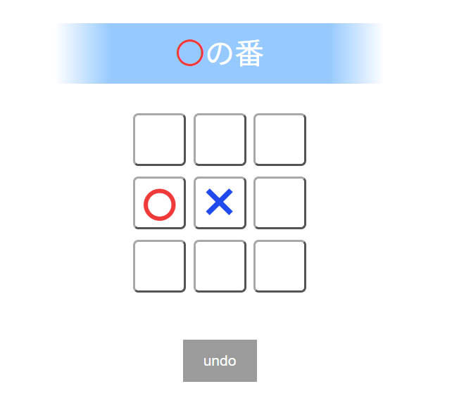

## ColorTile
HTML・CSS・JavaScriptを用いて作成したパズルゲームです。
授業課題として作成したJavaプログラムをもとに、Webアプリとして再実装しました。
UIは授業内で配布された雛型を参考にしていますが(Main.java)、タイル探索アルゴリズムやゲームロジックは自分で実装しています。

  

## portfolio-site
HTML・CSS・JavaScriptを用いて作成した、私のポートフォリオサイトです。
モーダル機能やスクロールアニメーションを実装し、FormSubmitを利用したお問い合わせフォームも実装しています。

  

## marubatu
HTML・CSS・JavaScriptを用いて作成した○×ゲームです。 アルゴリズムはyoutubeの動画を参考にし、UIや演出に力を入れました。

  

